# system_bringup_pkg

## 대회 PC 두 대의 I/O 연결 (2026-10-01)

PC A(MORAI)는 `192.168.0.1/24`, PC B(참가팀)는 `192.168.0.10/24`로
유선 직결한다. 양쪽 유선 Gateway와 DNS는 비운다.
PC B에서 아래 명령으로 본선 네트워크 I/O와 자율주행 스택 전체를 한 번에 시작한다.

```bash
roslaunch system_bringup_pkg competition.launch
```

`competition.launch`는 Camera/GPS/IMU/LiDAR, Competition Vehicle Status,
CollisionData 수신과 Localization, TF/RViz, HD Map, Route Manager,
LiDAR Perception, World Model, Frenet Planner, Vehicle Controller,
Safety Supervisor, Ego Ctrl Cmd 송신을 한 번에 실행한다.

본선 I/O 시작 인자는 기본 `true`이며 제어는 `dry_run: false`,
`allow_motion_commands: true`다. 기존 `frenet_rddf.launch`의 개발용
Control Sender는 `send_to_morai:=false`로 비활성화하고,
`config/competition/control.yaml`을 사용하는 본선 Control Sender만 한 번 실행한다.

RViz 없이 실행하거나 시험 속도 상한을 적용하려면 다음처럼 사용한다.

```bash
roslaunch system_bringup_pkg competition.launch rviz:=false
roslaunch system_bringup_pkg competition.launch test_speed_cap_kph:=10.0
```

| 채널 | MORAI Host Port | MORAI Destination Port | 팀 코드 설정 |
|---|---:|---:|---|
| Competition Vehicle Status | 9088 | 9099 | `0.0.0.0:9099` 수신 |
| CollisionData | 9091 | 9092 | `0.0.0.0:9092` 수신 |
| Ego Ctrl Cmd | 9093 | 9094 | `192.168.0.1:9093` 송신 |

위 3개 쌍은 사용자가 제공한 대회 Network 표 기준이다. MORAI의 Host IP는
`192.168.0.1`, Destination IP는 `192.168.0.10`으로 설정한다.
`UdpSender`는 Host Port `9093`으로 `sendto()`하며 로컬 송신 포트는 OS가
할당한다. 표의 Destination Port `9094`는 MORAI 설정에 기록하는 값이며,
현재 코드가 `9094`를 송신 목적지나 고정 로컬 송신 포트로 사용하는 것은 아니다.
MORAI 공식 [UDP 예제](https://help-morai-sim-en.scrollhelp.site/morai-sim-standard-en/msc-udp-unit-test-quick-start-manual)도
제어 sender의 목적지에 `ctrl_cmd_host_port`를 사용한다.

센서 포트는 대회 고정 3개 채널과 구분된 팀 선택값이다. MORAI Sensor 설정의
Destination IP를 `192.168.0.10`으로 바꾸고 아래 Destination Port를 맞춘다.

| 센서 | Destination Port |
|---|---:|
| Front Camera | 9291 |
| Left Camera | 9293 |
| Right Camera | 9295 |
| GPS | 7801 |
| IMU | 7802 |
| VLP16 LiDAR | 2368 |

카메라 포트는 제공 센서 JSON 기준이며 GPS·IMU·LiDAR는 기존 팀 설정을
사용한다. `참고파일들/`의 원본 카메라 JSON은 loopback IP가 포함된 원본으로
보존되므로, 불러온 뒤 MORAI에서 IP를 변경해야 한다.
중앙 [UDP 계약](../ros_architecture_pkg/config/morai_interface/udp_ros_bridge.yaml),
[대회 실행 프로필](config/competition_network.yaml),
`morai_interface_pkg/config/competition/`과 개별 브리지 기본 설정의 포트를 함께 맞췄다.
네트워크 설정 일치는 실제 패킷·축·조향 변환 검증 완료를 뜻하지 않는다.

## 한 번에 실행

저장소 루트에서 `./run.sh`로 센서, Localization, RViz,
Frenet 회피 Planner, Controller, Safety와 MORAI 제어 송신을 함께 실행한다.
Ctrl+C로 이번 실행 전체를 종료한다. 기존 구성과 노드가 겹치면 시작을 거부한다.
MORAI 앱은 별도로 실행하고 Cmd Control `127.0.0.1:9093`을 Connect 상태로 둔다.

```bash
./run.sh
# 송신·RViz 없이 실행하거나, 실행하지 않고 구성만 검사:
./run.sh send_to_morai:=false rviz:=false
./run.sh --check
```

스크립트가 Noetic과 workspace 환경을 불러오며 `frenet_all.launch`를 실행한다.
launch는 MORAI 앱 자체를 켜거나 UI의
수동/자동 모드를 바꾸지 않는다. 기본값은 전방 카메라 수신·RViz·제어 송신 활성, 좌우 카메라 수신 비활성, 시험 상한 해제다.

`frenet_rddf.launch`는 기존 MORAI 센서·Localization 실행에 정적 지도, Route,
LiDAR 관측, World Model, Frenet Planner와 Controller→Safety 연결을 추가한다.
기존 global_path_demo와 중복 실행하지 않는다. 송신 기본값은 false이며,
`send_to_morai:=true`로 개발 주행을 활성화한다. 시험 상한은 기본적으로 해제하며
Q 전환은 기존 MORAI sender 동작을 유지한다.
[중앙 개발 프로필](../ros_architecture_pkg/config/messages/frenet_runtime.yaml)과
[통합 Planner 검증 범위](../path_planning_pkg/docs/planner_mode_integration.md)를 따른다.

> **PUBLIC INTERFACE LOCK v1.0.0:** 아래 node/topic/type은
> [`interface_contract.yaml`](../ros_architecture_pkg/config/interface_contract.yaml)의
> 읽기용 투영이다. 통합 시 정확히 일치해야 하며 이 README에서 독립 변경하지 않는다.

## 담당 범위

- 전체 시스템 launch 조합의 단일 소유권
- 파라미터 파일 연결, 시작 순서와 Safety 이전 upstream readiness 집계
- 중복 publisher, 잘못된 실행 모드와 필수 패키지 누락 방지
- 실시간 MORAI 모드와 offline replay 모드 분리

## 반드시 지킬 것

- 개별 패키지 launch는 해당 기능만 시작한다.
- MORAI와 rosbag/replay 공급자를 동시에 시작하지 않는다.
- Safety Supervisor가 준비되기 전에 주행 명령을 활성화하지 않는다.
- 각 runtime profile은 required/optional 채널을 명시하고, 중앙 UDP 계약에서
  `runtime_activation_allowed: false`인 채널을 required로 지정하지 않는다.
- `ros_architecture_pkg/config/tf/`에서 `publish_enabled: true`로 승인된 정적 TF만 단일 publisher로 시작한다.
- Live MORAI와 rosbag replay의 `use_sim_time` 정책을 섞지 않는다.
- 실행 이후 Operator 조작 없이 상태 확인과 fail-closed 종료가 가능해야 한다.

GPS blackout은 정상 운용 조건이다. GPS stale 또는 no-fix만으로 즉시 정지하지 않고,
fresh Local Odometry와 승인된 uncertainty 범위 안의 Localization quality를 함께 판단한다.
마지막 GPS fix를 현재 위치 정답처럼 재사용하지 않는다. 구체 required 채널 집합과
uncertainty/timeout 수치는 측정 근거가 있는 runtime profile에서 별도로 승인한다.

`localization_visualization.launch`는 기존 GPS/IMU 입력을 사용하여 개발 추정기,
중앙 계약의 GPS/IMU/LiDAR 정적 TF와 시각화를 시작한다. `visualization:=false`로 기존
시각화 노드와의 중복을 피한다. 센서·제어 송신은 시작하지 않는다.
`system_readiness_node`는 아직 미구현이며 주행 준비를 승인하지 않는다.

## 공개 ROS 입출력



- [Mermaid 원본](docs/interface_io.mmd)
- [PNG 이미지](docs/interface_io.png)

**공개 node (exact):** `system_readiness_node`

| 구분 | Topic | Type |
|---|---|---|
| 입력 | `/molit/interface/status` | `common_msgs_pkg/InterfaceStatus` |
| 입력 | `/molit/map/status` | `common_msgs_pkg/ComponentStatus` |
| 입력 | `/molit/perception/camera/status` | `common_msgs_pkg/ComponentStatus` |
| 입력 | `/molit/perception/lidar/status` | `common_msgs_pkg/ComponentStatus` |
| 입력 | `/molit/localization/status` | `common_msgs_pkg/LocalizationStatus` |
| 입력 | `/molit/route/status` | `common_msgs_pkg/ComponentStatus` |
| 입력 | `/molit/world_model/status` | `common_msgs_pkg/ComponentStatus` |
| 입력 | `/molit/planning/status` | `common_msgs_pkg/ComponentStatus` |
| 입력 | `/molit/control/status` | `common_msgs_pkg/ControllerStatus` |
| 출력 | `/molit/system/readiness` | `common_msgs_pkg/SystemReadiness` |

공유 타입 중 `ComponentStatus`, `EgoState`, `LocalizationStatus`, LiDAR 관측과
World Model 객체·scene과 제어 연결용 `Trajectory`·`ActuatorCommand`·`ControllerStatus` 스키마가 구현됐다.
해당 타입을 사용하는 공개 I/O는 [기반 메시지 계약](../ros_architecture_pkg/docs/core_messages.md)을 따른다.
나머지 custom type과 readiness 런타임 노드는 아직 미구현이다.
`/molit/system/readiness`는 Safety를 제외한 상류 필수 구성요소의 준비 상태다.
최종 주행 허용 여부는 순환 구독 없이 `safety_supervisor_node`가
`/molit/safety/state`로 결정한다.

## 통합 전 자체 확인

- readiness 공개 노드 이름은 정확히 `system_readiness_node`를 사용한다.
- 전체 launch가 같은 공개 노드를 중복 실행하거나 공개 topic을 remap하지 않는지 확인한다.
- 상류 필수 component가 unknown/fault이면 readiness를 false로 유지한다.
- 내부 topic은 `/molit/internal/system_bringup/...`만 사용한다.
- 중앙 계약 생성 검사와 launch 중복-publisher 검사를 통과시킨다.

## 디렉터리

- `config/`: 시스템 조합과 모드별 파라미터
- `docs/`: startup sequence, readiness와 운영 절차
- `launch/`: 승인된 전체 시스템 조합
- `src/`: 향후 readiness 보조 도구

## RViz HD Map + Localization

`roslaunch system_bringup_pkg localization_visualization.launch`는 기본으로 HD Map 차선(밝은 회색),
도로 중심선(청록색)과 로컬리제이션 차량을 같은 `map` 좌표계에 표시한다. GPS/IMU 수신은 먼저 실행해야 한다.
`show_hd_map:=false`로 지도 표시를 끌 수 있다. 지도 원본은 `hd_map_pkg`의 고정 MGeo submodule을 사용하고,
변환 원점은 중앙 `config/tf/map_projection.yaml`에서 읽는다. 지도는 화면에서만 평면으로 투영된다.
지도 마커는 visualization 내부 RViz 표시 전용이며 Localization의 입력이나 공개 HdMap 메시지가 아니다.

RViz 지도 범위는 기존 HTML 미리보기와 동일한 전역경로 주변 30 m + 북쪽 지정 경계 확장을 사용한다.
`hd_map_pkg/config/map_conversion.yaml`의 crop 설정을 공유하고 전역경로는 초록색으로 표시한다.

제어 연결용 `Trajectory`, `ActuatorCommand`, `ControllerStatus` 스키마도 구현됐다.
이 패키지의 예약 consumer는 [중앙 제어 계약](../ros_architecture_pkg/docs/controller_integration.md)을 따른다.

## 전역경로 추종 시험 (2026-09-21)

사용자가 요청한 현재 시뮬레이터 전용 실행은
[global_path_demo 중앙 프로필](../ros_architecture_pkg/config/messages/global_path_demo.yaml)을 따른다.
`roslaunch system_bringup_pkg global_path_demo.launch`로 기존 Localization에 연결해
전역경로만 10 km/h로 추종한다. 일반 실행과 구분된 개발용 직접 전달 경로이며
장애물·신호 판단을 수행하지 않는다. 별도 방어 계층은 추가하지 않았다.
실제 상태와 실행·중지 방법은 [실행 기록](../ros_architecture_pkg/docs/global_path_demo.md)에 기록한다.

`global_path_demo.launch`는 중앙 고정 코스 속도 규칙(일반 최대 58, 고주로 목표 150 km/h)과 곡률/감속 프로파일을 적용한다. 일반 순항 목표는 56 km/h다.

## PointPainting + RViz

`roslaunch system_bringup_pkg pointpainting.launch weights:=... python:=... rviz:=true`로 PIDNet 전방 추론, 점군 페인팅과 RViz를 실행한다. `rviz:=true`이면 기존 승인된 GPS/IMU/LiDAR static TF publisher를 함께 실행한다. 카메라 TF 발행과 LiDAR UDP 자동 활성화는 추가하지 않는다. 센서 입력과 표준 압축영상 플러그인 준비는 [보정·검증 기록](../world_model_pkg/docs/pointpainting_calibration.md)을 따른다.

## Camera3 YOLO 기본 실행

`./run.sh`는 Camera3 신호등 YOLO와 전용 UDP 수신을 기본 실행한다.
`camera3_yolo:=false`로 제외할 수 있다. MORAI의 `camera3signal_yolo` 센서
프리셋 로드가 필요하며 [설정·박스 영상 안내](../camera_perception_pkg/docs/camera3_yolo.md)를 따른다.
단독 실행은 `roslaunch system_bringup_pkg camera3_signal.launch`다.
기본 YOLO는 중앙 관측 정책의 1·2·3·5번 정지선 전방 30m부터 정지선까지
유효한 `/molit/route/context`가 있을 때만 추론하며 4번 우회전은 제외한다.
정지선 통과 또는 경로 정보 만료 시 후보를 무효화한다. 위치/Route 실행 없이
영상만 보는 명시적 단독 진단은 `signal_route_gate:=false`를 전달한다.
이번 연결은 개발용 하우징 후보 진단이며 주행 신호 판단은 포함하지 않는다.

## PIDNet 장애물 점 기반 통합 실행 (2026-10-15)

`frenet_all.launch`(`./run.sh`)와 `competition.launch`는 기본으로
`pidnet_enabled:=true`를 사용한다. 전방 RGB → PIDNet 6채널 확률 →
PointPainting → World Model 내부 장애물 군집/추적 → 기존 Planner 순서다.
이 모드에서는 `lidar_perception_node`를 실행하지 않고 raw-only 검출로 되돌아가지 않는다.
World Model의 내부 `/molit/internal/world_model/pidnet_points`는 다른 패키지가 구독하지 않는다.

중앙 `config/messages/pointpainting.yaml`의 foreground 정책으로
person/animal/box/bollard/barrier argmax 및 확률 0.7 이상인 실제 LiDAR 반환점만 선택한다.
배경, 카메라 시야 밖, NaN과 낮은 확률 점은 제외한다. 모델에 차량/신호 클래스는 없다.
Softmax는 보정된 객체 confidence가 아니므로 추적 객체 confidence는 -1을 유지한다.
원본 LiDAR 좌표·field·측정시각과 카메라 측정시각을 보존한다.
객체 군집은 World Model의 `config/world_model.yaml`에서 클래스별 0.4 m voxel
인접성, 최소 3점으로 설정한다. 배경 지면 기반 기존 LiDAR 검출은 사용하지 않는다.

RViz는 `pidnet_vehicle.rviz`로 PIDNet 장애물 점만 RGB로 표시한다.
기존 LiDAR/World Model 장애물 marker 표시는 꺼지고 지도·차량·trajectory는 유지한다.
입력 단절 시 마지막 점군을 재발행하지 않으며 RViz 점 표시의 유지 시간은 0.5초다.
World Model은 측정시각과 상태 watchdog으로 stale 결과를 거부한다.
객체가 없는 결과는 free-space 증거가 아니다. 개발 calibration/freshness와
planner_ready 검증 제한은 유지한다.

기본 PIDNet 가중치는 저장소의 `weights/pidnet_s_morai6.pt`이며, YOLO 가중치도
같은 디렉터리에 포함한다. 외부 학습 폴더를 복사할 필요가 없다.
[가중치 목록·환경 준비](../../weights/README.md)를 따른다.
Python 기본값은 `~/venvs/morai-pidnet/bin/python`이고, YOLO 동시 실행은
`~/venvs/morai-yolo/bin/python`을 사용한다. 다른 환경은 인자로 지정한다.

```bash
./run.sh pidnet_weights:=/absolute/path/best.pt pidnet_python:=/absolute/path/python
./run.sh send_to_morai:=false rviz:=false
# 기존 LiDAR 검출을 명시적으로 사용하는 비교 실행:
./run.sh pidnet_enabled:=false
```

두 launch를 중복 실행하지 않는다. PIDNet 구현은 `paik`으로 통합했다.
새 코드는 기존 run.sh 터미널에서 Ctrl+C 후 이 작업 폴더에서 다시 실행한다.

검증: catkin build 및 관련 catkin 테스트 137개(오류·실패 0), 중앙 계약/다이어그램 검사를 통과했다. 합성 ROS producer/consumer 통합에서 foreground 선별·map 추적·
원본 stamp 보존·배경/후방 제외·카메라 단절 및 raw-only fallback 부재를 확인했다.
실제 best.pt GPU 추론은 현재 live 입력 3쌍으로 확인했다. 첫 추론 워밍업 후
추론은 약 58~70 ms, 전체 처리 약 123~143 ms였다. 당시 foreground는 0점이었으며
실제 장애물 검출 성능, 동적 calibration과 MORAI closed-loop 주행은 검증하지 않았다.
근거는 `/home/paik/morai-artifacts/pidnet-detection-live-probe.json`에 있다.

### paik 통합 실행

`./run.sh`는 PIDNet과 Camera3 YOLO를 기본으로 카메라 노드 하나에서 함께 실행한다.
YOLO가 활성화되면 두 모델을 지원하는 `signal_python` 환경을 사용하고,
YOLO를 끄면 `pidnet_python`을 사용한다. 두 모델은 별도 최신 영상 worker로 처리한다.
`pidnet_enabled:=false`는 PIDNet만, `camera3_yolo:=false`는 YOLO만 끈다.
사람 추적 객체를 받으면 Planner의 최대 목표속도는 20 km/h로 제한된다.
YOLO 하우징 후보는 계속 진단 전용이며 신호 주행 판단에 연결하지 않는다.

검증(2026-10-15): 의존성 underlay를 포함한 catkin 빌드, 관련 5개 패키지 테스트
209개(오류·실패 0), launch/XML/YAML 및 중앙 계약·다이어그램 검사를 통과했다.
격리 ROS master의 단일 카메라 노드에서 실제 가중치로 PIDNet 확률 영상 7개와
YOLO 표시 영상 2개를 동시에 발행하고 원본 stamp 보존을 확인했다. 입력은 합성
검정 영상이며 실제 사람 검출률이나 MORAI closed-loop 감속 성능 검증은 아니다.
증거: `/home/paik/morai-artifacts/paik-pidnet-person-*.log`,
`paik-pidnet-yolo-dual-probe.py` 및 `paik-pidnet-yolo-dual-probe.log`.
기존 runtime의 World Model age 1.0초에 중앙 기록을 맞췄으며 실행 임계값은
변경하지 않았다. 저장 센서 profile은 GPS/IMU scope의 ID·장착값·frame·주기를
재확인한 뒤 근거 해시만 갱신했다. TF 장착값과 발행 설정은 바꾸지 않았다.

Camera3 공개 HSV 관측은 World Model에서 지도 head에 대응하고 두 Planner 모드의
정지·재출발에 연결한다. RViz 기존 World Model marker 레이어에 같은 상태를 표시한다.
WorldModel message 변경 후 전체 빌드와 모든 producer/consumer 재시작이 필요하다.
